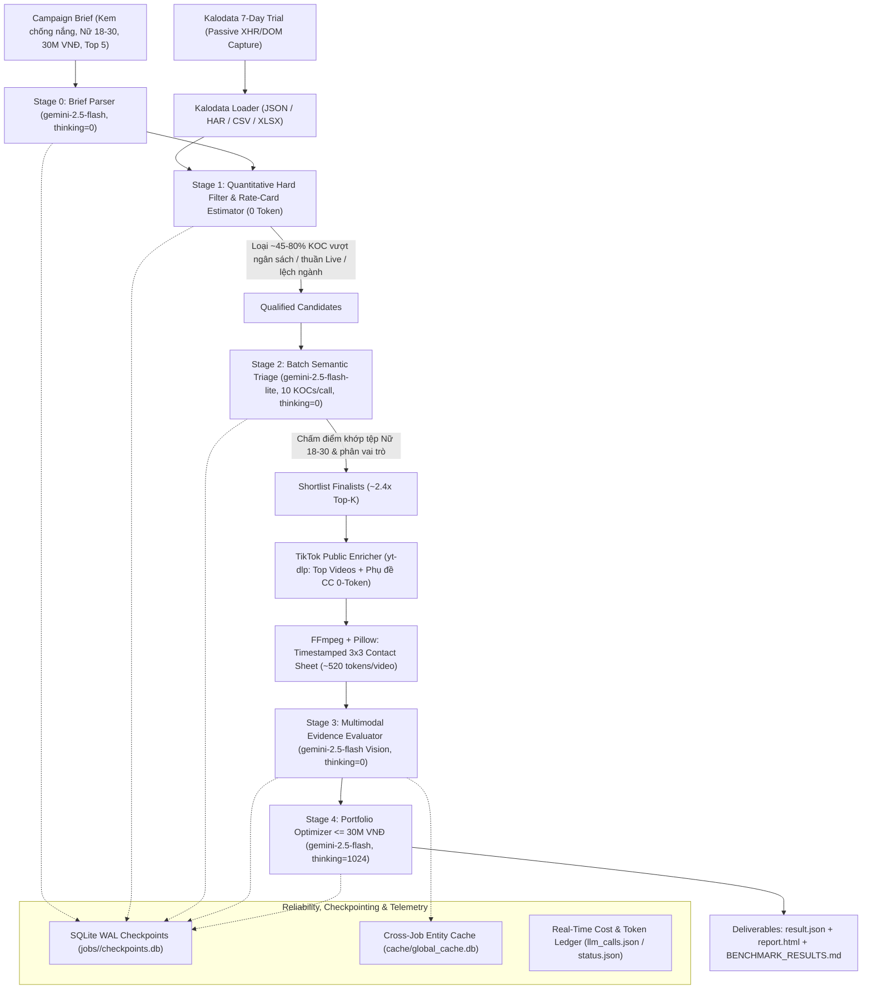

# DETOLA — Kiến Trúc Hệ Thống AI KOC Discovery

## 1. Tổng Quan Kiến Trúc (Multi-Stage Cost-Optimal Funnel)

Để giải quyết bài toán nghiên cứu từ **50 đến 500+ KOC** có phân tích sâu tới từng khung hình video nhưng vẫn giữ chi phí AI ở mức vài cent USD, hệ thống DETOLA loại bỏ hoàn toàn cách tiếp cận ngây thơ (*đẩy toàn bộ hồ sơ và raw video MP4 vào LLM*). Thay vào đó, chúng tôi thiết kế **Phễu lọc 5 tầng (Cascading Funnel)** theo triết lý:

> **"Zero-Token Toán học trước → Cheap-Token Gom lô ở giữa → Nén Khung hình Đa phương thức ở cuối"**

---

## 2. Các Quyết Định Thiết Kế Trọng Tâm (Key Architectural Decisions)

### 2.1. Quy đổi Ràng buộc Kinh doanh sang Toán học `0-Token` (Stage 1)
- **Vấn đề thực tế:** Ngân sách tổng **30.000.000 VNĐ cho 5 KOC** (trung bình ~5–6 triệu VNĐ/KOC, chừa dự phòng gửi hàng mẫu seeding). Nếu hệ thống đề xuất các Macro/Mega KOL (500K–1M followers, phí 25–80 triệu/clip) hoặc các shop xả kho chỉ bán qua Livestream (tỷ trọng doanh thu Video < 25%), đề xuất sẽ **vô giá trị về mặt thương mại** dù chỉ số GMV rất cao.
- **Giải pháp:** Stage 1 nội suy mức phí booking 1 video tại thị trường Việt Nam từ `followers`, `avg_video_views` và `video_revenue_30d_vnd`, sau đó lọc cứng và chấm điểm hiệu quả **ROI trên mỗi triệu đồng booking** hoàn toàn bằng Python (`0 LLM token`).

### 2.2. Nén Video Đa phương thức bằng "Timestamped 3x3 Contact Sheet + TikTok CC" (Stage 3)
- **Vấn đề chi phí:** Một video TikTok 45 giây truyền thẳng vào Multimodal LLM tiêu tốn **~12.000 – 15.000 input tokens**. Nhân với 2 video/KOC cho 100–500 KOC sẽ tiêu tốn hàng triệu token và rất dễ đụng giới hạn băng thông/rate-limit.
- **Giải pháp kết hợp 2 kỹ thuật:**
  1. **0-Token Transcript:** Khai thác trực tiếp luồng phụ đề `.vtt` có sẵn trên TikTok qua `yt-dlp` (`writesubtitles`/`writeautomaticsub`), nén thành chuỗi văn bản gắn mốc `[mm:ss]` mà không tốn chi phí gọi mô hình Speech-to-Text.
  2. **Timestamped 3x3 Contact Sheet:** Dùng `ffmpeg` trích xuất **9 khung hình chiến lược** (Hook `0.5s`, Cận mặt & ánh sáng `2.5s`, 6 khung thân bài test chất kem/thoa lên da, và CTA cuối video), đóng dấu nhãn `#1 [00:01] HOOK OPEN` ... `#9 [00:35] FINAL LOOK & CTA` rồi ghép thành **1 ảnh JPEG duy nhất (`1080x1140`, ~120KB)**.
- **Hiệu quả:** Mỗi video chỉ tốn **~500–760 image tokens + ~250 text tokens** (giảm **>93% lượng token video**), đồng thời giúp Gemini Vision trích dẫn chính xác mốc giây `[mm:ss]` làm bằng chứng thuyết phục nhãn hàng.

### 2.3. Kiểm soát `thinking_budget` theo Tầng và Phân tầng Model Gemini 2.5
Trên dòng mô hình Gemini 2.5, token suy luận ngầm (*thinking tokens*) được tính theo đơn giá **Output** (\$2.50/1M trên `gemini-2.5-flash` — đắt gấp 8.3 lần Input). Nếu để mặc định cho mọi tác vụ trích xuất JSON, chi phí sẽ đội lên gấp 3–5 lần không cần thiết:
- **Stage 0, Stage 2 (`gemini-2.5-flash-lite`), Stage 3 (`gemini-2.5-flash`):** Đặt `thinking_budget=0` vì đầu vào và schema đánh giá đã được cấu trúc hóa rõ ràng.
- **Stage 4 (`gemini-2.5-flash`):** Cấp `thinking_budget=1024` duy nhất cho bài toán tối ưu tổ hợp 5 KOC bổ trợ vai trò trong trần 30 triệu VNĐ.

### 2.4. Thu thập Hybrid An toàn cho Kalodata 7-Day Free Trial
- Bản dùng thử 7 ngày của Kalodata khóa xuất Excel và giới hạn gắt gao số lượt bấm vào trang chi tiết từng KOC mỗi ngày.
- Hệ thống tách bạch:
  - **Kalodata** chỉ dùng để thu thập **chỉ số thương mại cốt lõi trên bảng tìm kiếm tổng** (GMV, Tỷ trọng Video/Live, GPM, Followers, Ngành hàng) thông qua script `scripts/kalodata_console_capture.js` (bắt gói JSON XHR hoặc quét bảng DOM không tốn lượt click chi tiết).
  - **TikTok công khai (`yt-dlp`)** đảm nhận phần làm giàu danh sách video mới nhất, lượt xem, phụ đề và khung hình cho nhóm Finalists hoàn toàn miễn phí.

### 2.5. Độ tin cậy (Crash Recovery) & Lưu vết Phiên chạy (`jobs/<job_id>/`)
- Toàn bộ trạng thái hoàn thành của từng `(stage, koc_id)` được ghi tức thời vào **SQLite chế độ WAL (`checkpoints.db`)** kèm ghi file JSON nguyên tử (`.tmp` -> `replace`) cho `status.json`, `llm_calls.json`, `api_calls.json`, `log.txt`.
- Khi mất mạng, hết quota tạm thời hoặc nhấn `Ctrl+C` giữa Stage 3, lệnh `uv run detola resume <job_id>` sẽ bỏ qua toàn bộ các KOC đã phân tích xong với chi phí **`0 token`** và tiếp tục từ đúng KOC bị dở.
- Ngoài ra, `GlobalEntityCache` (`cache/global_cache.db`) lưu kết quả phân tích cấp `video_id` xuyên suốt nhiều chiến dịch để tránh phân tích lại cùng một video KOC.

---

## 3. Khả Năng Mở Rộng Lên 50 – 500 KOC (Scalability Design)

Khi nâng quy mô từ đề bài demo (chọn 5 KOC từ 30–60 ứng viên) lên quy mô thực tế (**chọn 50 KOC từ 500 ứng viên** hoặc **500 KOC từ 5.000 ứng viên**):
1. **Stage 1 (`0 token`)** xử lý 5.000 hồ sơ trong `< 50ms` trên 1 nhân CPU.
2. **Stage 2 (`gemini-2.5-flash-lite`, gom 10 KOC/prompt)** quét 1.000 KOC đạt chuẩn chỉ với **100 lời gọi nhẹ**, tổng chi phí chưa tới **\$0.03 USD**.
3. **Stage 3 (Multimodal Contact Sheet)** có thể phân mảnh bất đồng bộ qua hàng đợi worker (`MAX_MEDIA_CONCURRENCY` & `MAX_LLM_CONCURRENCY`) kết hợp `tenacity` exponential backoff.
4. **Stage 4 (Hierarchical Portfolio Map-Reduce khi Top-K >= 50):** Với nhu cầu chọn 50–500 KOC, thay vì nhét 500 hồ sơ vào 1 context duy nhất, Stage 4 chia theo từng nhóm vai trò (*Role Buckets*: Ingredient Expert, Makeup Finish, Outdoor Tester, Deal Closer) với hạn ngạch ngân sách con cho từng nhóm rồi gộp kết quả cuối cùng.
